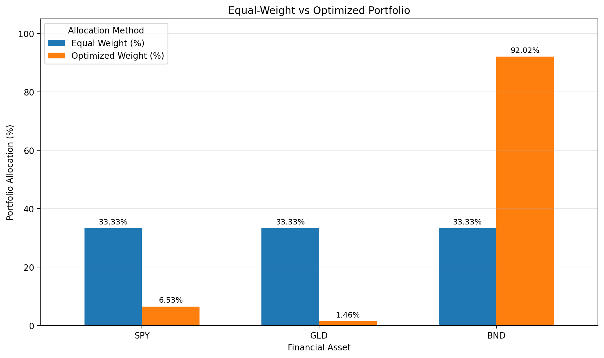
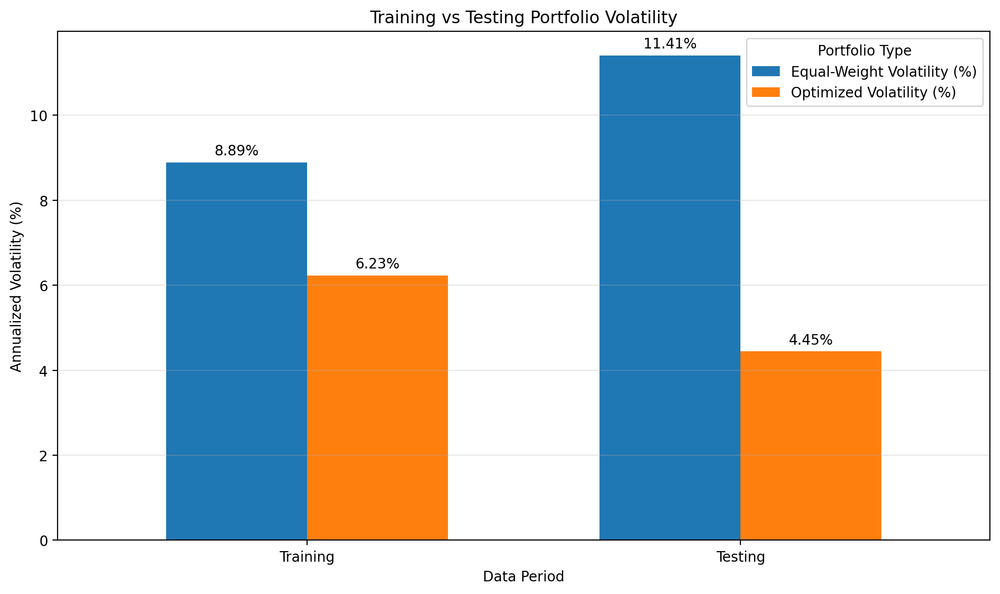
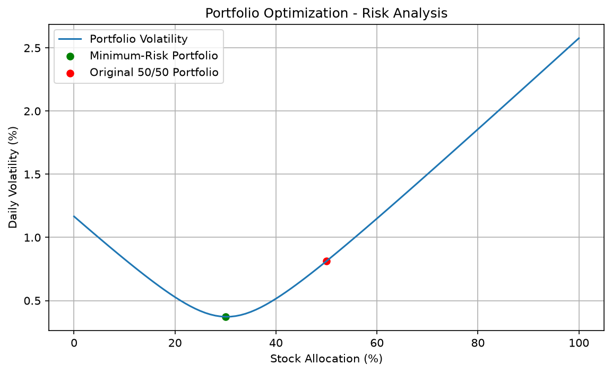

# Portfolio Diversification & Risk Optimization

## Live Interactive Dashboard

Try the Portfolio Diversification & Risk Optimization
dashboard online:

[Open Live Dashboard](https://portfolio-diversification-and-risk-optimization-qgdttmifrnzdrb.streamlit.app/)

### Dashboard Features

- Historical ETF performance analysis
- Portfolio volatility and correlation analysis
- Minimum-variance portfolio optimization
- Constrained portfolio optimization
- Out-of-sample risk and return comparisons
- Interactive financial charts

Upload a compatible CSV containing Date, SPY,
GLD and BND columns to explore the analysis.


### Financial Data Analytics | Quantitative Finance | Python

## Project Overview

This project analyzes historical financial market data
to understand portfolio diversification, risk, and
asset allocation.

It compares three portfolio strategies:

1. Equal-Weight Portfolio
2. Minimum-Variance Portfolio
3. Constrained Minimum-Variance Portfolio

The project uses Python, financial statistics, and
mathematical optimization to evaluate the trade-off
between portfolio risk and return.

## Objectives

- Analyze historical ETF prices and returns.
- Measure volatility, correlation, and covariance.
- Optimize portfolio allocations using SciPy.
- Compare risk and cumulative returns.
- Evaluate performance using unseen historical data.
- Visualize financial results using an interactive dashboard.

## Technologies Used

- Python
- pandas
- NumPy
- SciPy
- Matplotlib
- Streamlit
- Google Colab
- Git and GitHub

## Financial Assets

| ETF | Asset Class |
|-----|-------------|
| SPY | US Equities |
| GLD | Gold |
| BND | US Investment-Grade Bonds |

Data Source: Yahoo Finance (via yfinance)

Historical Data: January 2021 - September 2026

## Methodology

### 1. Exploratory Data Analysis

Downloaded adjusted historical ETF prices and
calculated daily returns.

Compared historical performance using normalized
price charts.

### 2. Risk Analysis

Calculated:

- Daily and annualized volatility
- Correlation matrix
- Covariance matrix
- Maximum drawdown
- Historical Value at Risk (VaR)
- Sharpe ratio

### 3. Portfolio Optimization

Used SciPy's SLSQP optimization method to minimize
estimated portfolio variance.

Constraints:

- Total portfolio weights equal 100%.
- No short-selling or leverage.
- Constrained strategy: 10%-60% in each asset.

### 4. Out-of-Sample Testing

Training Period: 2021-2024

Testing Period: 2025-September 2026

Portfolio weights were calculated using training data
only and evaluated on the later testing period.

## Out-of-Sample Results

| Portfolio | Annual Volatility | Total Return |
|-----------|-------------------|--------------|
| Equal-Weight | 11.41% | 31.67% |
| Minimum-Variance | 4.45% | 6.70% |
| Constrained | 7.80% | 20.44% |

Results are historical and specific to the selected
dataset, model assumptions, and evaluation period.

## Key Findings

- Minimum-variance optimization reduced observed
  portfolio volatility during testing.
- The unconstrained optimizer allocated approximately
  92% of the portfolio to BND.
- The equal-weight portfolio generated the highest
  cumulative return during the testing period.
- Allocation constraints produced a more diversified
  portfolio with an intermediate risk-return profile.
- Lower volatility did not necessarily mean higher
  investment returns.

## Project Visualizations

### Portfolio Allocation Comparison



### Training vs Testing Volatility



### Portfolio Risk Curve




## Run the Dashboard

In a compatible Python environment, install the
required libraries:

```bash
python -m pip install -r requirements.txt
```

Start the Streamlit application:

```bash
streamlit run app.py
```

## Financial Data Input

The dashboard allows users to upload their own CSV
file containing historical adjusted ETF prices.

The CSV must contain these columns:

- Date
- SPY
- GLD
- BND

Example CSV structure:

| Date | SPY | GLD | BND |
|------|-----|-----|-----|
| 2025-01-02 | 100 | 100 | 100 |
| 2025-01-03 | 101 | 99 | 100.5 |

The example values above are illustrative.

The downloaded Yahoo Finance dataset is kept locally
and is not included in the public GitHub repository.

Users must upload a compatible CSV before the dashboard
can display portfolio analysis and optimization results.


## Assumptions and Limitations

- Historical data does not predict future returns.
- Portfolio performance assumes daily rebalancing
  to fixed target weights.
- Transaction costs, taxes, and slippage are excluded.
- Optimization uses historical covariance estimates.
- Asset relationships can change over time.
- ETF data is used rather than futures contract data.
- The testing results do not guarantee future performance.
- Data redistribution is subject to the provider's terms.

## Disclaimer

This project is for educational and research purposes
only and does not constitute investment advice.
